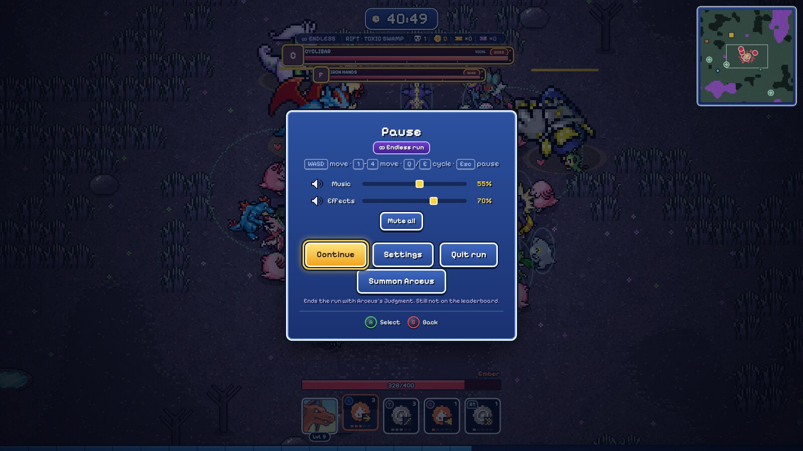
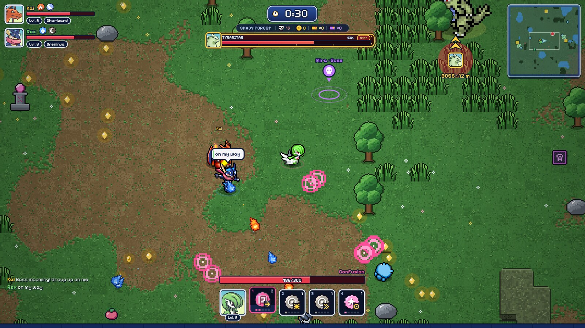
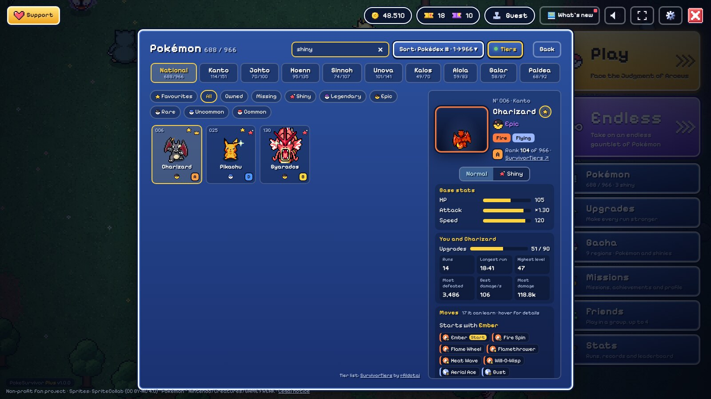
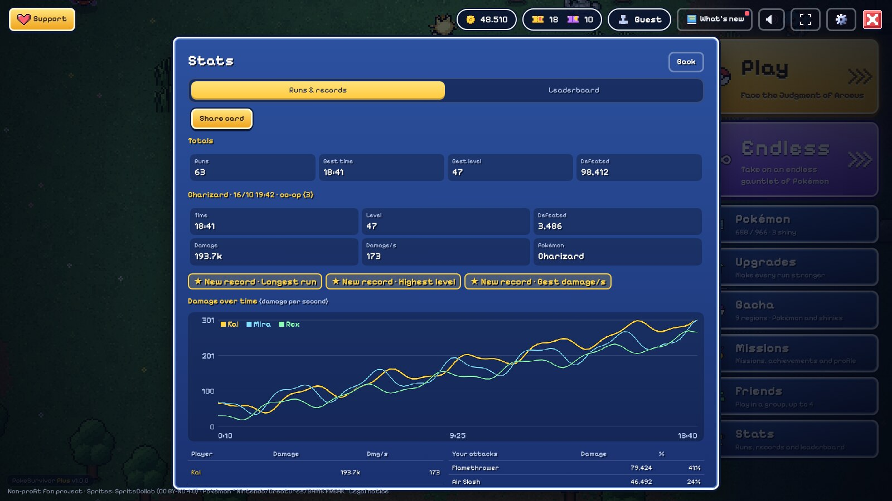
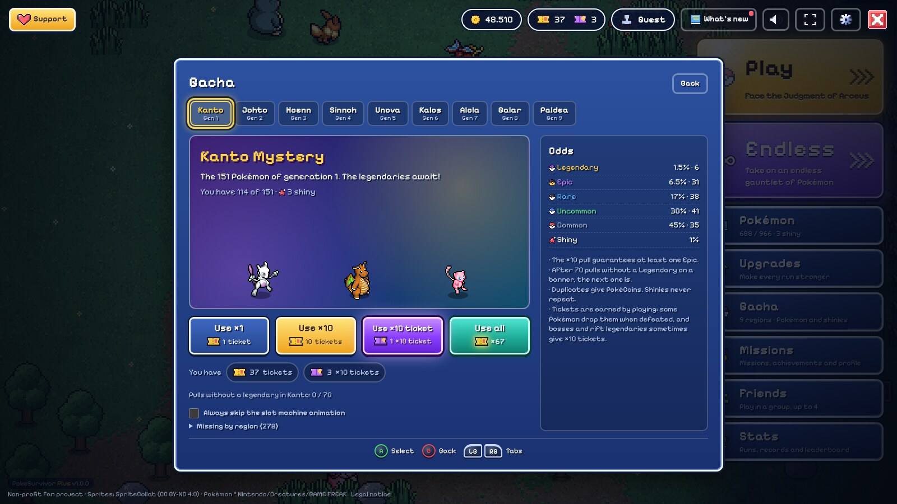
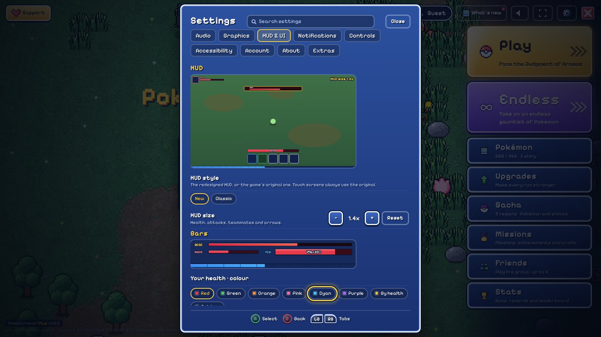
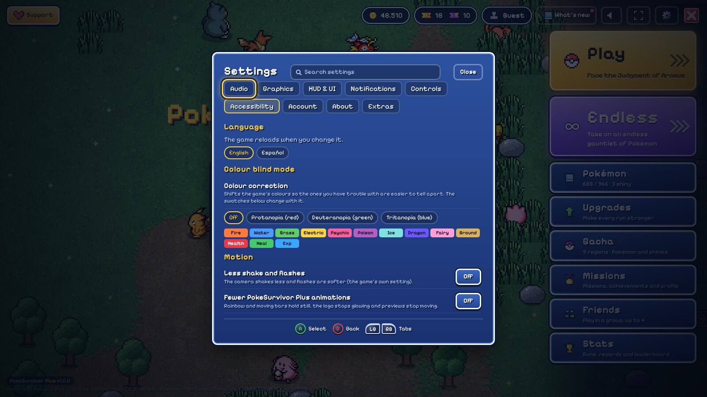

# PokeSurvivor Plus — Features

Everything PokeSurvivor Plus 1.0 adds to [PokéSurvivor](https://pokesurvivor.com/). Each feature is part of the extension in [`extension/`](extension/); almost all of them can be switched off or adjusted in the game's **Settings** screen.

**Contents:** [Main menu](#main-menu) · [Endless runs](#endless-runs) · [Redesigned HUD](#redesigned-hud) · [Damage meter](#damage-meter-and-upgrades-panel) · [Minimap](#minimap) · [Co-op](#co-op) · [Controller](#controller-support) · [Pokémon screen](#pokémon-screen) · [Stats & share cards](#stats-runs-and-share-cards) · [Upgrades & gacha](#upgrades-and-gacha) · [Settings](#settings) · [Accessibility](#accessibility-and-display) · [Audio & music](#audio-and-music) · [Notifications](#notifications) · [Quality of life](#quality-of-life) · [Keyboard shortcuts](#keyboard-shortcuts) · [Limitations](#notes-and-limitations)

---

## Main menu

- **Play** is a big gold button on its own at the top (“Face the Judgment of Arceus”), with bold lettering and a light that sweeps across it. **Endless** sits right under it, the same size, in purple (“Take on an endless gauntlet of Pokémon”).
- Every other option is its own button. **Stats** (the game's Leaderboard item) opens your runs and records first, with the leaderboard as a second tab.
- **Quit** is a red ✕ at the far right of the top bar: it saves what's pending, then closes the tab. **Support** sits in the top-left corner.
- The top-bar buttons (Settings, sound, full screen, What's new) light up under the mouse. Clicking your name opens your profile, which has a **Log out** button (press twice as a guest, whose progress isn't saved).
- **Favourites on the menu:** arrows beside your partner swap between your favourite Pokémon (Q / E, or LB / RB on a controller), each remembering normal or shiny. **View / Select** on a controller, or **Tab**, swaps your partner between Normal and Shiny.
- **Room on the main menu (co-op):** while you're in a room, the party, the room's status, its chat and Invite / Leave room sit under your partner. **Play** starts the co-op run for everyone (host), says who you're waiting for (guest), or plays solo if you're alone.
- **Party strip:** in a group, a strip under your partner shows every member, the Pokémon they picked and its upgrade level (★ host, ✦ shiny).
- A different **splash text** (over a hundred) pulses under the logo each time you come back, and the Pokémon wandering behind the menu are sometimes shiny (about 1 in 64).
- The version (“PokeSurvivor Plus v1.0.0”) sits at the bottom left; click it for what's new. A **Now playing** card slides in at the bottom right when a new song starts.
- The menu scales down to fit short windows.

## Endless runs

The purple **∞ Endless** button starts an endless run; the gold **Play** button starts a normal one.

- Arceus's Judgment doesn't come at 30:00. The run goes on the way runs did before the Judgment was added: nothing changes until minute 60, then enemy health (and a little less their damage) grows faster and faster — about ×1.4 at 90 minutes and ×3.8 at 2 hours, also for bosses and rift legendaries.
- Rifts keep opening, and a boss comes every 3 minutes.
- **Summon Arceus** from the pause menu (which shows “∞ Endless run” at the top) to end the run with the Judgment. In co-op, only the host can start an endless run or summon Arceus.
- **Fair to the leaderboard:** an endless run is never registered with or sent to the leaderboard (Arceus or not), unlocks no achievements, and leaves the game's stats exactly as they were — runs, best time (solo and co-op), best level, defeated, bosses and legendaries. Coins, tickets, missions and Pokémon you catch are kept as in any run.
- Endless records (best time solo and co-op, best level, number of runs) are kept separately in Stats. Endless runs carry an ∞ badge on the clock panel, in your run history, on the end-of-run screen and on share cards.
- Teammates without PokeSurvivor Plus play along, but their own game counts the run as a normal one.

## Redesigned HUD

- **Teammate cards** top-left: portrait, name, typing, health, level, Pokémon and held item (the item shows when they and the host use PokeSurvivor Plus).
- **Clock panel:** the run time on its own plate, with a strip for the biome, defeated enemies, coins and tickets (×1 and ×10) picked up this run. Hover the weather tag under it to see what that weather changes.
- **Boss plate:** a portrait that winces and shakes when the boss takes damage (and shows its angry face when enraged), name, BOSS / LEGENDARY / ENRAGED tag, and a health bar with a lingering damage trail, hit flash and a red glow below 25%.
- **Bottom bar:** your boosts, the active move's name, health, portrait and level, your move slots and a full-width experience bar. Hover a move slot or your item for its details (damage, cooldown, pierce, range, effects and next upgrade).
- **Arrows:** teammates out of view get an arrow with their portrait; bosses get a framed portrait in a pulsing red halo with “BOSS · N m” (purple for legendaries). Arrows stay clear of the team cards and the minimap and slide apart when they'd overlap.
- **Rifts:** an open rift out of view gets an arrow with a swirl icon; on screen, a small tag floats over the portal. Inside a rift arena, a purple card under the clock counts down the fight.
- **Treasure thieves:** when a Meowth (coins) or Gholdengo (×10 ticket) shows up, a tag under the clock shows what it carries and drains as its 15 seconds run out, then reads “CAUGHT!” or “GOT AWAY”. Out of view it gets a gold arrow with distance and time left.
- **Down and revives:** when you're down, the screen edge pulses red and a panel shows who can revive you and the revive progress; reviving someone shows a bar.
- **Big chests:** a clear opening meter with the percentage instead of the game's thin ring.
- Portraits come from SpriteCollab, the artwork source the game uses for its sprites: a normal face, a pained face after a real hit and a dizzy one when down.
- The HUD scales from 1× to 2× (default 1.4×). Switch back to the game's original with Settings → HUD & UI → HUD style → Classic (touch screens always use the original). The clock panel, rift, thief and boss extras need the new HUD.

## Damage meter and upgrades panel

- Hold **Tab** (or press View / Select on a controller) for the damage panel: each player's total damage, damage per second and share of the team's damage, plus who is down. Click your row to see damage from each of your attacks.
- Under it, your multipliers and stats (damage, cooldown, speed, defense, regeneration, critical hits, magnet, experience, active upgrades and item). In co-op it also shows shared Learning, team experience and enemy scaling per player.
- Choose **Press to toggle** in Settings → Controls to make Tab show and hide it; “Always show the damage panel” keeps it on screen. Drag the “DAMAGE” title to move it.
- In co-op, players with the extension send their damage to the host, who shares it with everyone (inside messages the game already sends). The host also sees estimated damage for players without it, marked with `~`. The meter counts direct attack damage; burn and poison over time are listed separately in your solo breakdown.

## Minimap

- Nearby terrain, teammates, enemies, chests and ground items, slightly transparent in the top-right corner. Drag it anywhere; drag a corner to resize it. `Alt` + `N` shows or hides it.
- Settings → HUD & UI → Minimap turns each kind of marker on or off, with a live preview.

| Marker | Meaning |
|---|---|
| White arrow in the centre | You, pointing where you move |
| White rectangle | Current screen view |
| Coloured circles | Teammates, each in their colour |
| Small red dots | Regular enemies |
| Large red circle | Boss |
| Large purple circle | Legendary |
| Cyan circle | Shiny |
| Yellow circle | Golden enemy or thief |
| Purple ring | Rift (portal) |
| Yellow diamond | Map event |
| Brown / yellow square | Chest / big chest |
| Cyan diamond | Altar |
| Coloured squares | Ground items: healing (green), magnet (pink), bomb (orange), tickets (purple), items (yellow) |
| Green circle with a white cross | Healing puddle (faded while it refills) |

Bosses, legendaries, shinies, rifts, events and teammates stay pinned to the map edge when out of range, showing their direction.

## Co-op

- **Pings:** hold **G** (or the middle mouse button; R3 on a controller) for a wheel — point at **Help**, **Boss**, **Chest** or **Here** and let go; a quick tap pings Here. Pings last 6 seconds with a world marker or an edge arrow, a sound for each kind and a line in the chat.
- **Chat:** a chat box in the room, and **Enter** during a run (Enter sends, Esc closes). Recent messages fade in the bottom-left corner and pop up in a bubble over the sender's Pokémon. Messages go straight between players over the game's own connection; nothing is stored. Only players with PokeSurvivor Plus see it, and the host must have it too.
- **Pause for everyone:** the host can pause the whole game (enemies, timer and spawns stop for every player, even those without the extension). Anyone with PokeSurvivor Plus can vote to pause or resume; it happens once half the players vote. The host needs PokeSurvivor Plus.
- **Spectate while down:** the camera follows a teammate while you wait to be revived (switch with Q / E, the wheel or LB / RB), with an arrow back to where you fell. With the host on PokeSurvivor Plus you also see the enemies around them.
- **Fewer disconnects:** if the connection between players drops, the extension waits up to 30 seconds for it to come back instead of removing the player straight away (the host retries after 15 seconds). It also stops Chrome from discarding the game tab to save memory. `Alt` + `L` opens a connection log.
- Works best when everyone — especially the host — has PokeSurvivor Plus.

## Controller support

- Xbox, PlayStation, Switch Pro, Steam Deck / Steam Controller and most other USB or Bluetooth controllers. Button prompts are drawn like the real buttons and named for your controller (picked automatically or in Settings → Controls).
- Every action can be rebound in Settings → Controls (`Alt` + `K`), and the controller rumbles when you take damage. Controller support and rumble can each be turned off.
- **Menus** get a yellow cursor: the D-pad or left stick moves it, **A** selects, **B** goes back, **LB / RB** switch tabs and **LT / RT** a window's second row of tabs (the leaderboard's Solo / Group). The cursor stays inside the open window and starts on something you can see.
- Button prompts are part of the open window (a strip along its bottom), or at the bottom left of the main menu.
- On level-up, bond and item cards, X / Y / B (and RT for a 4th) pick a card directly. Drop-down lists open as controller-friendly lists.

| Action | Button (Xbox names) |
|---|---|
| Move | Left stick or D-pad |
| Previous / next attack | LB / RB |
| Attack or upgrade 1 / 2 / 3 | X / Y / B |
| Attack 4 | RT |
| Change upgrade | LT |
| Pause | Menu (Start) |
| Damage panel | View (Select), toggles |
| Ping (co-op) | R3 |

If nothing happens, press any button once: browsers only report a controller after it has been used on the page.

## Pokémon screen

- **National** tab with every Pokémon together, beside the region tabs.
- **Search** by name or Pokédex number; type **shiny** for every Pokémon whose shiny you have.
- **Sort** by Pokédex number, A–Z, HP, Attack, Speed or tier, either way round.
- **Combined filters:** one of All / Owned / Missing / Shiny plus any number of rarities, together with Favourites and the search. With Shiny (or a “shiny” search), Pokémon are shown as their shiny.
- **Favourites:** the ★ next to a Pokémon's name; favourites get a star in the grid and their own filter.
- **Pokémon page:** sprite beside the name, rarity and types with the Normal / Shiny switch; base stats; **You and this Pokémon** (upgrade level and personal records); and every move it can learn as a chip (hover for type, kind, damage, cooldown, range and effects).
- **Personal records** for every Pokémon: longest run, highest level, most defeated, best damage per second, most damage and runs played. Beating one is announced at the end of the run.
- **Tier letters** (optional, off by default): press **Tiers** to show each Pokémon's tier from the community tier list [SurvivorTiers](https://survivortiers.pages.dev/en/) by @fildotai, with its rank and a link under its name. The list is downloaded when you switch it on and kept for a day.

## Stats, runs and share cards

- **Stats** on the main menu (also on the game-over screen, or `Alt` + `H`) opens your totals and latest runs. Click a run for its time, level, defeats, damage, damage per second, a **damage-over-time graph** (one line per player), strongest attacks and how teammates did.
- **Share card:** an image of the run to copy into a chat or save, with the stats, a labelled damage-per-second graph and, in co-op, everyone's share of the team's damage.
- The last 30 runs are kept in your browser; ✕ removes one (click twice). A red dot on Stats means a new run was saved.
- **Profiles:** a player's profile shows their three favourites as portraits with types and tier, their records as tiles, and whether a friend is online or in a run.

## Upgrades and gacha

- **Max all upgrades:** one button buys every missing upgrade level for the selected Pokémon (click twice to confirm), cheapest first if your coins don't cover them all. The total upgrade level (out of 90) is shown beside it.
- **Move shortcuts:** each opens a list of the Pokémon's moves with their type icons. Tighter upgrade cards, with Ban's button inside its card.
- **Repertoire option:** “Start with one move even if Repertoire is owned” (coins aren't refunded; toggle any time).
- **Gacha:** **Skip animation**, **Always skip**, and **Use all** to spend every ticket on a banner at once (×10 tickets first, then regular tickets in tens, keeping the guaranteed epic per ten). Each button says what it does and costs.
- **Missing by region:** Pokémon owned and missing per region, pulls until each banner's guaranteed legendary, and the missing Pokémon list.

## Settings

The extension's options live inside the game's own Settings screen (also from the pause menu), with a **search box** that looks through every tab and jumps to the setting.

- **Audio:** volume sliders with percentages (also in the top bar's sound panel and the pause menu), Mute all, More music and the alert sound with a Test button.
- **Graphics:** the game's quality options, plus field of view and attack effects, each with a live preview.
- **HUD & UI:** HUD style and size (live preview), bars (live preview), the minimap and its markers (live preview), the damage panel, and a debug view with player and enemy **hitboxes** and an **FPS counter** you can drag anywhere.
- **Notifications:** which pop-ups, middle-of-screen messages, arrows and tags show.
- **Controls:** controller support and rumble, button prompt style, the damage panel key and every key / button binding.
- **Accessibility:** language, colour blind mode, less shake and flashes, and fewer PokeSurvivor Plus animations.
- **Extras:** co-op options, tier list letters, **Backup** (export / import all PokeSurvivor Plus settings, bindings, favourites, records and runs), **Status** (every feature and whether it's working), help and credits.
- **Bars:** colours for your health (including “by health”), teammates' health, boss health and experience; a style for every bar (classic, flat, gradient, segmented, moving stripes, or rainbow); numbers on the health, experience and boss bars; and thin / normal / thick bars.

## Accessibility and display

- **Colour blind mode:** a screen colour correction for protanopia (red), deuteranopia (green) or tritanopia (blue), tuned on the game's own colours so pairs like health red / heal green, Fire / Grass and Electric / Bug end up 3–5× further apart. Strength from 20% to 160%.
- **Less shake and flashes** (the game's setting) and **fewer PokeSurvivor Plus animations**.
- **Wider field of view:** zoom the camera out (1.0×–1.7×, default 1.4×).
- **Attack effects:** opacity and size (down to 20%) for your attacks and, separately, your teammates'. Only the look changes; hit areas stay the same.
- **Level-up screen:** always the same size, every card the same height, and **Pause · Esc** (Start) opens the pause menu over the cards.

## Audio and music

- **42 new tracks** written in the game's own music format and played by its synthesiser: five more for the main menu, four more for each area, five more for boss fights, two more for Arceus's Judgment and three for each family of rift arenas. A track is picked at random each time, never the one you heard there last.
- A song always plays on the main menu (also after a run); **Now playing** shows its name for about 15 seconds when it starts (not while music is muted).
- **Alert sounds** for a shiny appearing and a teammate going down, plus sounds for chat messages and pings. `Alt` + `B` toggles the alert sound.

## Notifications

- The only pop-ups left by default are a shiny appearing and a teammate going down. The game's messages in the middle of the screen (wild Pokémon, events, rifts, biome names…) are hidden by default; turn each kind back on in Settings → Notifications.

## Quality of life

- **Welcome tour:** six short cards for new players (replay from Settings → Extras → Help).
- **What's new:** the game's What's new screen gets a PokeSurvivor Plus tab with every version's changes.
- **Safety net:** each part of the extension is checked against the game. If a game update breaks one, just that part switches off (for example, the HUD falls back to the game's own), the rest keeps working, and Settings → Extras → Status shows what happened.
- **Custom controls:** rebind actions, and use the mouse wheel (switches attacks by default) or middle / side mouse buttons.
- **Evolving a move** keeps the attack you had selected; learning a new move no longer switches you to it.
- **Translation fixes** for a few English texts, including English names for the Paradox Pokémon.

## Keyboard shortcuts

| Action | Keys |
|---|---|
| Damage panel | Hold `Tab` (or press, if set to toggle) |
| Damage panel on / off | `Alt` + `M` |
| Bindings | `Alt` + `K` |
| Field of view wider / narrower / reset | `Alt` + `+` / `Alt` + `-` / `Alt` + `0` |
| Runs and records | `Alt` + `H` |
| Alert sound on / off | `Alt` + `B` |
| Minimap on / off | `Alt` + `N` |
| Connection log | `Alt` + `L` |
| Ping (co-op) | Hold `G` or the middle mouse button |
| Chat (co-op) | `Enter` |
| Switch tabs in menus | `Q` / `E` |
| Normal / Shiny partner (main menu) | `Tab` |

## Notes and limitations

- PokeSurvivor Plus runs only on `pokesurvivor.com`, in Chromium-based desktop browsers. Firefox, Safari and mobile browsers aren't supported.
- With a wider field of view, enemies can appear farther away because the game spawns them outside the camera; very wide settings may cost performance.
- Colour blind mode filters the whole page; very old or low-end machines may see a small performance cost.
- The extension hooks into the game's internals, so a game update can temporarily break a feature until PokeSurvivor Plus is updated. The safety net switches off just that part.
