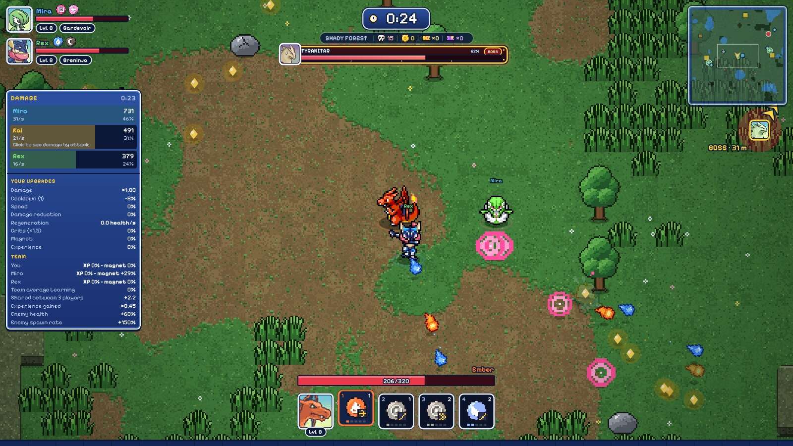
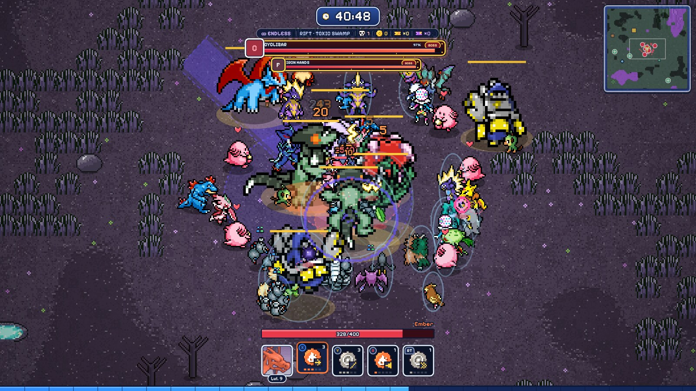
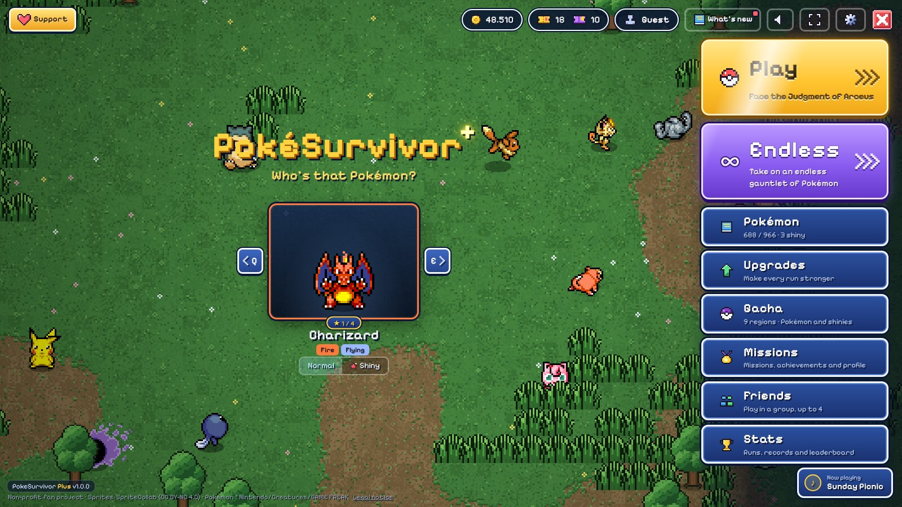
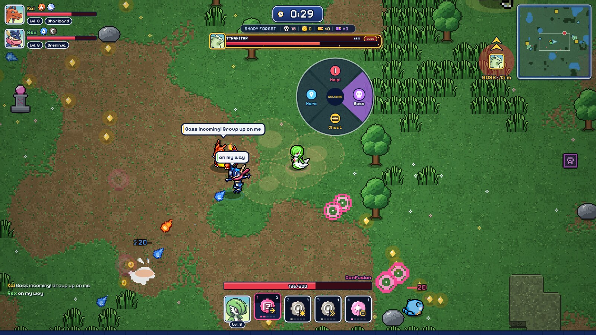
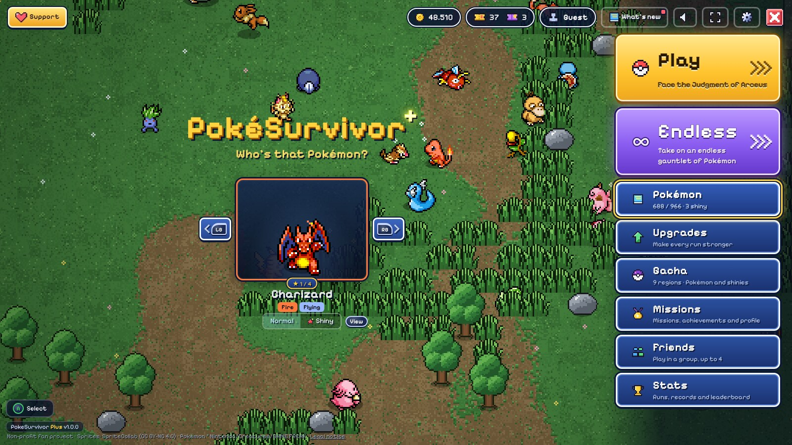
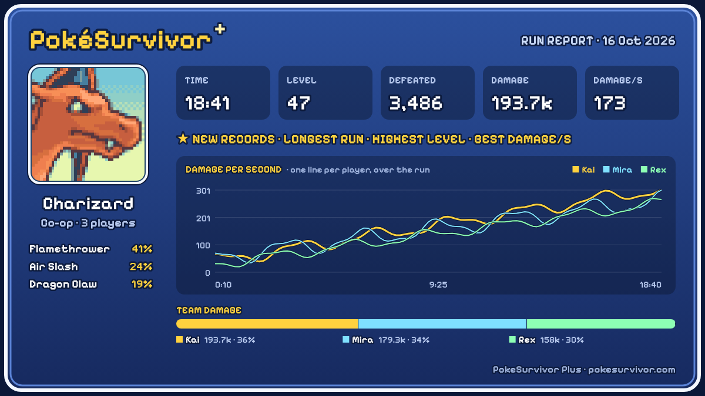
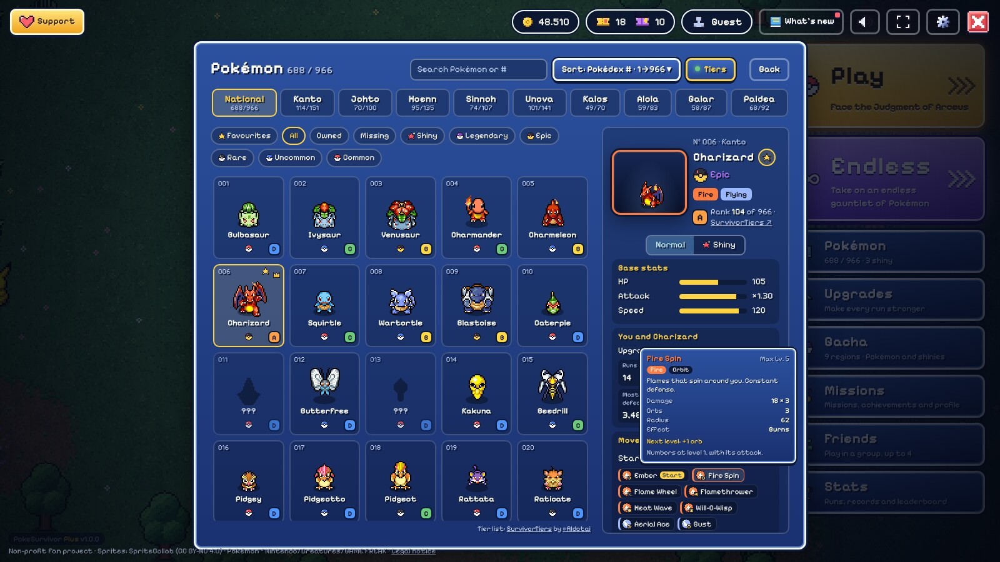

# PokeSurvivor Plus

**A free browser extension that makes [PokéSurvivor](https://pokesurvivor.com/) better:** 
Endless runs, a redesigned HUD, a damage meter, a minimap, full controller support, co-op chat & pings, and dozens of quality-of-life upgrades.

[**⬇ Download**](https://github.com/PokeSurvivorPlus/PokeSurvivorPlus/releases/latest) ·
[Install guide](INSTALL.md) ·
[All features](FEATURES.md) ·
[Website](https://pokesurvivorplus.github.io/PokeSurvivorPlus/) ·
[Changelog](CHANGELOG.md)

Unofficial fan project — not affiliated with PokéSurvivor's developer, Nintendo, Creatures, GAME FREAK or The Pokémon Company. See <a href="CREDITS.md">Credits & disclaimer</a>.

---

## Highlights

<table>
<tr>
<td width="50%" valign="top">

### ∞ Endless runs
No Judgment at 30:00 — keep surviving as enemies grow stronger and stronger, with rifts and bosses that keep coming. Summon Arceus from the pause menu when you're ready to end it. Endless runs **never touch the leaderboard**, achievements or your game stats, and keep their own records.

</td>
<td width="50%" valign="top">

</td>
</tr>
<tr>
<td valign="top">

</td>
<td valign="top">

### 🎮 A cleaner game, start to finish
A redesigned main menu with big Play and Endless buttons, a new HUD with team cards, boss plates and smart arrows, a **damage meter** (hold Tab), a draggable **minimap**, and 42 new music tracks in the game's own style.

</td>
</tr>
<tr>
<td valign="top">

### 🤝 Better co-op
**Ping wheel** (Help / Boss / Chest / Here), **chat** with bubbles over players, **pause for everyone**, spectate while you're down, and protection against short disconnects.

</td>
<td valign="top">

</td>
</tr>
<tr>
<td valign="top">

</td>
<td valign="top">

### 🕹️ Full controller support
Xbox, PlayStation, Switch Pro and Steam controllers, with real button prompts built into every window, a menu cursor, rebindable buttons and rumble.

</td>
</tr>
<tr>
<td valign="top">

### 📊 Stats & share cards
Run history with damage-over-time graphs, personal records for every Pokémon, and a **share card** image of any run to post in your group chat.

</td>
<td valign="top">

</td>
</tr>
<tr>
<td valign="top">

</td>
<td valign="top">

### 📖 A smarter Pokémon screen
A National tab, search (type **shiny** to see all your shinies), sorting, combined filters, favourites, detailed move info and optional tier letters from SurvivorTiers.

</td>
</tr>
</table>

**Plus:** colour blind mode, wider field of view, customisable bars and HUD size, hitboxes and FPS counter, Max-all upgrades, faster gacha (Use all, skip animation), Settings search, backups, a welcome tour and more. **[See every feature →](FEATURES.md)**

## Install

> **Chrome Web Store: coming soon.** Until then, install it by hand in about two minutes:

1. Download **`pokesurvivor-plus-1.0.0.zip`** from the [latest release](https://github.com/PokeSurvivorPlus/PokeSurvivorPlus/releases/latest) and extract it somewhere permanent.
2. Open your browser's extensions page — `chrome://extensions`, `edge://extensions`, `brave://extensions` or `opera://extensions`.
3. Turn on **Developer mode**, click **Load unpacked** and select the extracted **`pokesurvivor-plus-1.0.0`** folder.
4. Open or reload [pokesurvivor.com](https://pokesurvivor.com/). All options are in the game's **Settings**.

Works in **Chromium-based desktop browsers** (Chrome, Edge, Brave, Opera…). Firefox, Safari and mobile aren't supported yet. Step-by-step help, updating and troubleshooting: **[INSTALL.md](INSTALL.md)**.

## Is it fair to the game?

Yes. PokeSurvivor Plus changes how the game looks and feels, not what's sent to the leaderboard. Endless runs are never registered with or sent to the leaderboard, unlock no achievements and leave your game stats exactly as they were. Everything else is interface, information and quality of life.

## Privacy

PokeSurvivor Plus has no accounts, analytics, ads or tracking, and sends nothing to its developer. Your settings and run history stay in your browser. It only contacts [survivortiers.pages.dev](https://survivortiers.pages.dev/en/) (if you turn on tier letters) and SpriteCollab on GitHub (Pokémon portraits). Co-op extras (chat, pings, damage numbers) travel between players over the game's own connection. Full details: **[Privacy policy](https://pokesurvivorplus.github.io/PokeSurvivor-Plus-Privacy/)**.

## Repository layout

| Path | What's in it |
|---|---|
| [`extension/`](extension/) | The extension itself, exactly as released (load this folder, or use the release zip) |
| [`FEATURES.md`](FEATURES.md) | Every feature, with screenshots |
| [`INSTALL.md`](INSTALL.md) | Installing, updating and troubleshooting |
| [`CHANGELOG.md`](CHANGELOG.md) | Version history |
| [`CREDITS.md`](CREDITS.md) | Credits, licences and disclaimer |
| [`docs/`](docs/) | The project website (GitHub Pages) |
| [`release-notes/`](release-notes/) | Release notes for each version |
| [`scripts/`](scripts/) | Builds the release zip from `extension/` |

## Feedback

Found a bug or have an idea? [Open an issue](https://github.com/PokeSurvivorPlus/PokeSurvivorPlus/issues/new/choose) or reach out on X: [@abslswrld](https://x.com/abslswrld).

## Credits & licence

Made by **ABSLS** ([@abslswrld](https://x.com/abslswrld)). Pokémon portraits from [PMDCollab SpriteCollab](https://github.com/PMDCollab/SpriteCollab) (CC BY-NC 4.0); tier letters from [SurvivorTiers](https://survivortiers.pages.dev/en/) by @fildotai; originally started from [pokesurvivor-mod](https://github.com/aparmor2/pokesurvivor-mod) by aparmor2. [PokéSurvivor](https://pokesurvivor.com/) is a free fan game by JPTER78. Pokémon © Nintendo / Creatures / GAME FREAK.

Released under the [MIT Licence](LICENSE). Full credits and third-party terms: [CREDITS.md](CREDITS.md).
